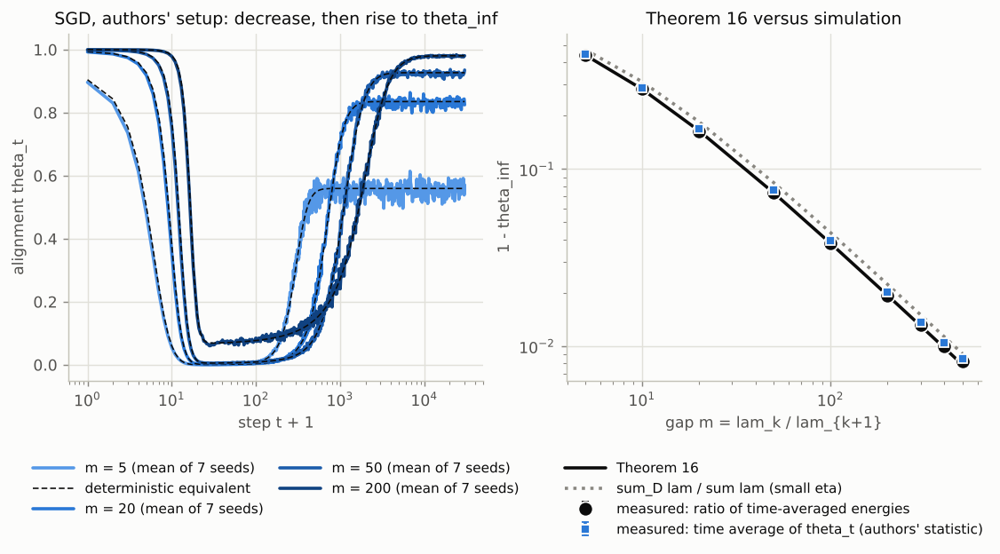
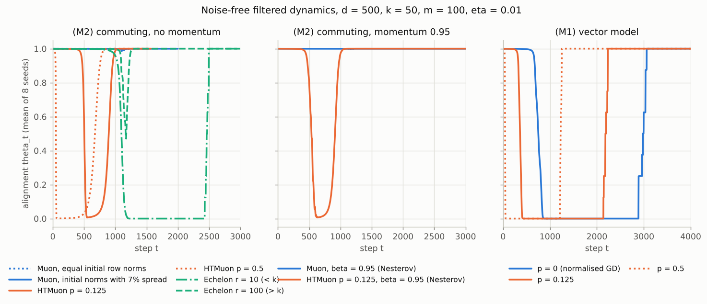
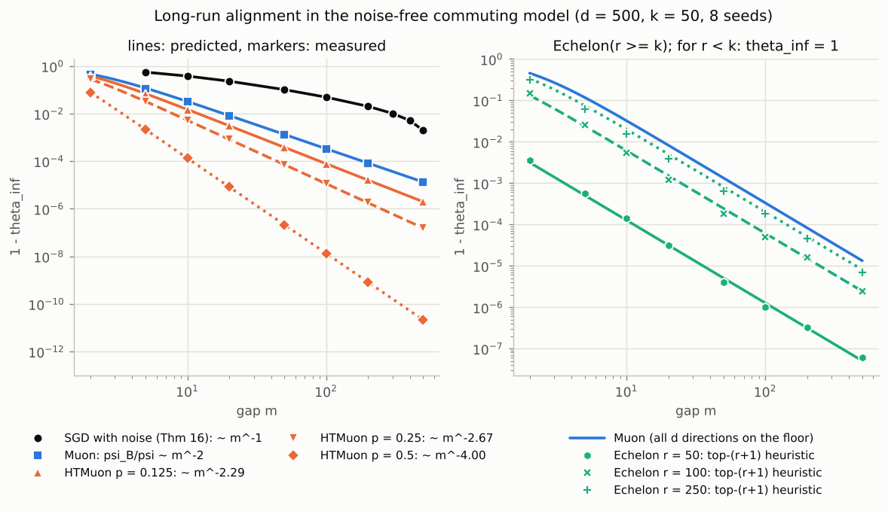
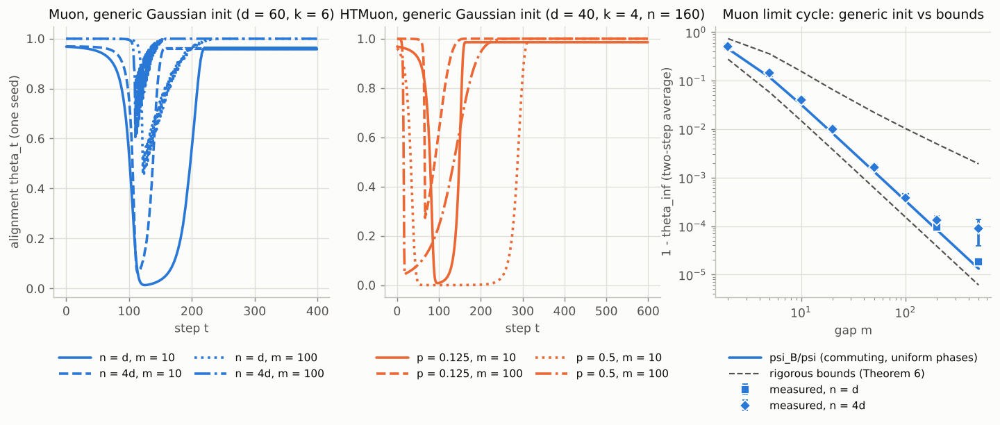
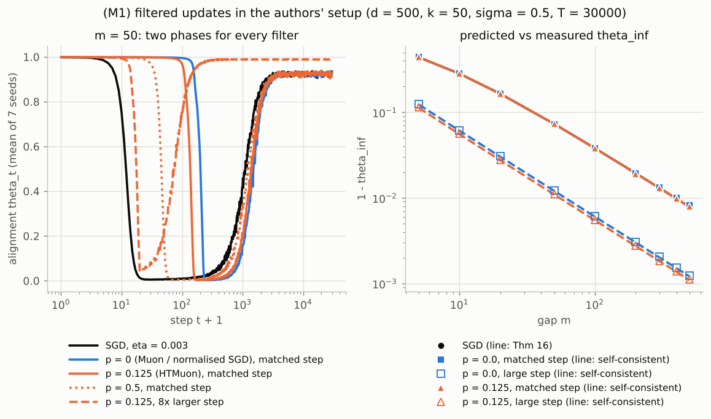
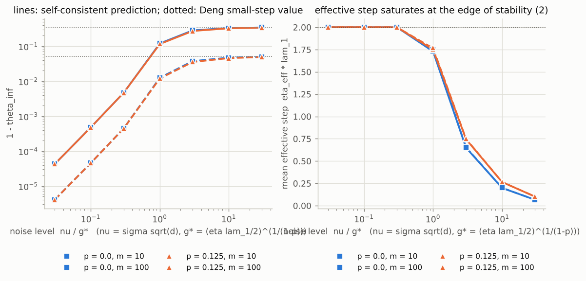
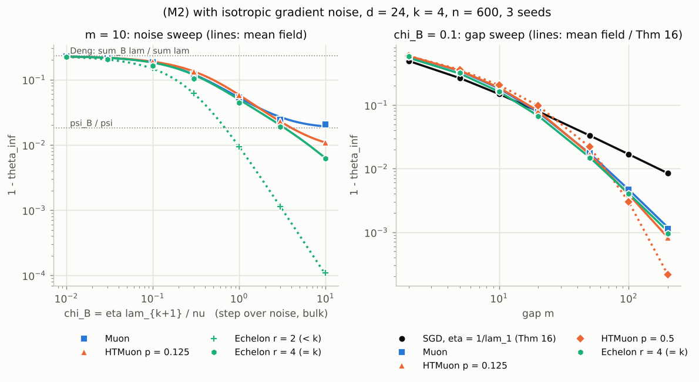

# Long-run (constant step size) dynamics of spectrally filtered updates in Deng's quadratic model

*Task key `theory-longrun`. Analogue of Section 6 (Theorems 15–16) and of the "stable band" picture of
Section 4 of Deng, Liao, Ouyang, Pang, Song, Yang, "Suspicious Alignment of SGD" (arXiv:2601.11789v2),
for Muon / HTMuon / Echelon.*

> This file is generated: prose in `sim/theory_longrun/note_template.md`, tables inserted from
> `sim/theory_longrun/results/*.json` by `sim/theory_longrun/build_note.py`. Edit the template, not this file.
> Status labels used throughout: **[proved]** (proof given here), **[numerical]** (simulation only; sizes and
> seeds stated), **[heuristic]** (derivation with an uncontrolled approximation, then tested), **[conjecture]**.

## 0. Summary

Setting: quadratic loss with Hessian eigenvalues `λ_1 ≥ … ≥ λ_k > λ_{k+1} ≥ … ≥ λ_d > 0`, gap
`m = λ_k/λ_{k+1}`, alignment `θ = Σ_{i∈D} λ_i²|c_i|² / Σ_i λ_i²|c_i|²`, constant step `η`, update
`W⁺ = W − η F(G)` with spectral filter `f(σ) = σ^p` (`p = 1` SGD, `p = 0` Muon, `p = 1/8` HTMuon) or
Echelon(r). Write `q := 2/(1−p)` and `ψ_S := Σ_{i∈S} λ_i²`.

1. **SGD baseline reproduced.** In the authors' own setup (d = 500, k = 50, η = 0.003, σ = 0.5, T = 30000,
   7 seeds, m ∈ {5,…,500}) the alignment first drops (to 2·10⁻⁴ … 0.29) and then rises to Theorem 16's
   `θ_∞ = Σ_D λ_i²β_i / Σ_i λ_i²β_i`; predicted and measured `θ_∞` agree to within 9·10⁻⁴ for every `m`
   (Table T1, Fig. 1). Three caveats about the paper's experiment are documented in §2.
2. **A step-size floor replaces the noise floor.** Without any gradient noise, a filtered update with
   `p < 1` cannot converge: in the commuting model each eigen-direction ends on a period-2 orbit whose
   gradient energy is `(ηλ_i/2)^q` for HTMuon (a fixed point of the modulus, globally attracting) and
   `λ_i² w_i`, `w_i ∈ [η²/4, η²/2)` for Muon **[proved]**. Hence
   `θ_∞ = Σ_D λ_i^q / Σ_i λ_i^q` (HTMuon; exact, measured to 10⁻¹⁵) and
   `θ_∞ ∈ [ψ_D/(ψ_D+2ψ_B), 2ψ_D/(2ψ_D+ψ_B)]`, `≈ ψ_D/ψ` (Muon). Compared with Deng's
   `Σ_D λ / Σ λ` for SGD, the exponent of the spectrum goes from `1` to `q = 2/(1−p) ≥ 2`
   (`16/7` for `p = 1/8`): `1 − θ_∞ ~ m^{−q}` instead of `m^{−1}`, and `θ_∞` no longer depends on `η` or on
   the noise.
3. **With gradient noise the two laws are the two ends of one curve.** In (M2) with `d ≪ n` a
   row-decoupled mean field gives the stationary gradient energy
   `E_i = (ηλ_i/2) g_i^{1+p}`, `2(g_i² − ν²) = ηλ_i g_i^{1+p}` (`ν` = noise norm per row) **[heuristic]**,
   which is Deng's `λ¹` law when noise dominates (`ηλ_i ≪ ν^{1−p}`) and the `λ^q` floor law when the step
   dominates; always `Σ_D λ/Σ λ ≤ θ_∞^{MF} ≤ Σ_D λ^q/Σ λ^q` **[proved for the mean-field formula]**.
   Measured energies agree with it within 0.5 % for HTMuon in every regime and for Muon when noise
   dominates (Table T7). In (M1) the long-run alignment is Theorem 16 evaluated at a self-consistent
   effective step `η_eff ≤ 2/λ_1` **[heuristic]**, accurate to 3–4 digits (Tables T2, T6b).
4. **Two phases: yes for HTMuon and for (M1), not gap-driven for Muon in (M2).** For `p > 0` the dominant
   block reaches its floor at `T_D ≈ a_0^{1−p}/((1−p) η λ_k^p)`, the bulk at
   `T_B ≈ a_0^{1−p}/((1−p) η λ_d^p)`; in between the alignment collapses and then rises **[proved bounds]**.
   `T_D` replaces Deng's `t*`: it is polynomial (not logarithmic) in the initial distance and needs no noise.
   For Muon all directions descend at the same speed `η`; with equal initial coefficient sizes the
   alignment is exactly constant, and any dip is caused by the spread of the initial condition and
   vanishes like `m^{−2}` **[proved / numerical]**.
5. **(M1) is an edge-of-stability system.** `x⁺ = x − η‖g‖^{p−1} g` is gradient descent with effective step
   `η‖g‖^{p−1}`, which grows as the gradient shrinks until `η_eff λ_1 = 2`. Noise-free limit: a period-2
   orbit on the top eigenvector, `θ_∞ = 1` exactly for every `m > 1` **[proved: existence and linear
   stability; numerical: global convergence]**.
6. **Echelon(r).** Noise-free, the tail (which sees SGD with step `η/τ`) decays to zero and `r+1`
   directions stay on Muon cycles: `θ_∞ = 1` if `r < k`; if `r ≥ k`, `1 − θ_∞ ≈ Σ_{k<j≤r+1} λ_j²/ψ_D`
   (only `r+1−k` bulk directions keep energy) **[proved: necessary condition; numerical: values]**. With
   noise Echelon follows the Muon mean field on the head and Deng's law with step `η/τ` on the tail.
7. **Momentum** (β = 0.95, Nesterov-EMA as in `muon.py`) does not change the exponent `q` noise-free
   (exact scale covariance; the 2-cycle energy becomes `x_c(β)^{2−q}(ηλ_i)^q/4`, `x_c(0.95) = 26.9`)
   **[proved]**, but with noise it makes the stationary energy *sub-linear* in `λ` between `x ≈ 1` and
   `x_c`, so `θ_∞` can fall **below** Deng's `Σ_D λ/Σ λ` (0.641 measured vs 0.769 at m = 10)
   **[heuristic closed form, verified]**.
8. **Caveats.** For Muon the value `ψ_D/ψ` is exact only for commuting states with uniform phases; from
   generic initialisations or with weak noise the bulk carries more energy and `1 − θ_∞` is 1.2–7 times
   larger (rigorous bounds in Theorem 6 allow a `1/m` term). Newton–Schulz based variants lose the floor for
   singular values far below `‖G‖_F` (§3.6). All results are for the quadratic model.

What this means for the paper's takeaways is stated in §8; Lean-ready statements are in §9.

## 1. Setting and notation

**Models.** (M2): `W ∈ ℝ^{d×n}`, `L(W) = ½ tr(WᵀAW)`, `A = UΛUᵀ`, stochastic gradient `G = AW + Ξ`,
update `W⁺ = W − ηF(G)`. Spectral filters are orthogonally equivariant, `F(UᵀG) = UᵀF(G)`, so with
`C := UᵀW` (rows `c_i ∈ ℝⁿ`) the dynamics is `C⁺ = C − ηF(ΛC + UᵀΞ)` and for isotropic noise `UᵀΞ` has
the law of `Ξ`. All simulations are run in these coordinates. Gradient energy of direction `i`:
`e_i := λ_i²‖c_i‖²`; `θ = Σ_D e_i/Σ_i e_i`; `L = ½ Σ_i λ_i‖c_i‖²`. (M1) is `n = 1`: a `d×1` gradient has
one singular value, so `F(g) = f(‖g‖) g/‖g‖`.

**Filters** `F(G) = U f(S) Vᵀ`:

| name | `f(σ)` | remark |
|---|---|---|
| SGD | `σ` | |
| Muon | `1` | exact polar factor |
| HTMuon(p) | `σ^p`, `0 < p < 1` | `msign_generalized_ht_v2`, default `p = 0.125` |
| Echelon(r), exact frame | `min(1, σ/τ)`, `τ = σ_(r+1)` | from `O = U_r P + T/τ`, `τ = ‖T‖₂`; the `(r+1)`-th direction also gets `f = 1` |

For `d ≤ n` and `G = KO` with `K = (GGᵀ)^{1/2}`, `OOᵀ = I_d` (left polar form): `F(G) = f(K)O`; Muon:
`F(G) = O`; HTMuon: `F(G) = K^pO`. The numpy ports were checked against a direct SVD (max error 5·10⁻¹⁴)
and the Echelon formula against the definition `U_rP + T/τ` (8·10⁻¹⁶) (`exp0_validate.py`).

**Momentum** (as in `muon.py`): `M_t = βM_{t−1} + (1−β)G_t`, filter input `(1−β)G_t + βM_t`. (The code's
factor `max(1, rows/cols)^{1/2}` is a constant rescaling of `η`.)

**Three notions of long-run alignment.** (a) `lim θ_t` if it exists; (b) the ratio of time-averaged block
energies, `θ_∞ := lim_T Σ_{t≤T}Σ_D e_i(t) / Σ_{t≤T}Σ_i e_i(t)` — this is what Theorem 16 computes (a
ratio of expectations) and it is our default; (c) the time average of `θ_t` (the estimator used in the
authors' script). (b) and (c) differ at finite `d` (§2).

**Regimes.** "Step-dominated": the per-direction step `ηλ_i` is large compared with the noise scale
(`ηλ_i ≫ ν^{1−p}`); "noise-dominated": the opposite. "Commuting" state in (M2): the rows `c_i` are
mutually orthogonal.

## 2. Baseline: constant-step SGD (Deng's Theorems 15–16)

**Proposition 2.1 (second moments) [proved; this is the lemma behind Theorem 16].** For SGD,
`c_i(t+1) = (1−ηλ_i)c_i(t) − ηζ_i(t)` with independent centred noise of variance `κ_i²`. If `0 < ηλ_i < 2`,
`𝔼c_i(t)² = (1−ηλ_i)^{2t}(c_i(0)² − β_i) + β_i`, `β_i = ηκ_i²/(2λ_i − ηλ_i²)`.

*Proof.* `v_t := 𝔼c_i(t)²` satisfies `v_{t+1} = (1−ηλ_i)²v_t + η²κ_i²`, whose fixed point is
`η²κ_i²/(1−(1−ηλ_i)²) = β_i`; subtract and iterate. ∎

Consequences: the deterministic equivalent `θ̄(t) := Σ_D λ_i²𝔼c_i(t)²/Σ_i λ_i²𝔼c_i(t)²` is explicit;
`θ̄(∞) = Σ_Dλ_i²β_i/Σ_iλ_i²β_i` is Theorem 16; for isotropic noise `λ_i²β_i = ησ²λ_i/(2−ηλ_i)`, so
`θ_∞ ≈ Σ_Dλ_i/Σ_iλ_i` for `ηλ_1 ≪ 1` and `1 − θ_∞ ≈ ((d−k)/k)·(mean bulk λ / mean dominant λ) ~ m^{−1}`.

**Remark 2.2 (noise-free gradient descent has no interior limit) [proved].** Without noise
`e_i(t) = (1−ηλ_i)^{2t}e_i(0)`, so the alignment tends to the block containing the slowest contraction
factor: `θ_t → 0` if `η < 2/(λ_1+λ_d)` and `θ_t → 1` if `2/(λ_1+λ_d) < η < 2/λ_1` (generic initial data).
Deng's interior value `θ_∞` exists only because of gradient noise. This is the point of comparison for §3:
filtered updates have an interior `θ_∞` *without* noise.

**Simulation in the authors' setup** (`exp1b_deng_setup.py`, spectrum, noise, step, horizon and seeds copied
from `deng-code/quad_sim.py`, run in the eigenbasis).

{{T1}}

Findings **[numerical]**:

* Theorem 16 is confirmed: `|measured (ratio of time-averaged energies) − predicted| ≤ 9·10⁻⁴` for all nine
  gaps (largest deviation at m = 20, 1.7 seed standard deviations).
* The two-phase curve is reproduced (Fig. 1, left): the seed-mean alignment falls from 0.90–1.00 to its
  minimum at `t = 24–49` and then rises. The minimum of the deterministic equivalent of Proposition 2.1
  is at `t = 24–31`, i.e. the explicit formula predicts the length of phase I.
* Caveat 1 (estimator). The authors' statistic, the time average of `θ_t`, is systematically below the
  ratio of expectations at finite `d` (0.5541 vs 0.5595 at m = 5; the gap closes as `m` grows). Theorem 16
  is a statement about the latter.
* Caveat 2 (stationarity). For `m ≥ 300` the slowest bulk direction has relaxation time `1/(ηλ_d) ≥ 8800`
  steps (14600 at m = 500), so at `T = 30000` the window average is still below the stationary value by up
  to 4·10⁻⁴; the finite-`T` deterministic equivalent (column 3) matches the measurement.
* Caveat 3 (Theorem 15). With `𝔼c_i(0)² = 1` Theorem 15's `t*` is 5.5, 3.8, 2.0 for m = 5, 10, 20 — a
  valid but very conservative lower bound on the observed decreasing phase (≈ 25 steps) — and for
  `m ≥ 50` the initialisation hypothesis `ϱ_D > δ − Σ_Dβ_i` of the paper's Assumption (Table "Assumptions
  for CSGD") is **not satisfied** by the paper's own experimental setup (`δ = 72 … 7038 > ϱ_D = 50`), so
  Theorem 15 guarantees nothing there although a decreasing phase is observed.

A second baseline run with a different spectrum (dominant block `[m, 1.2m]`, bulk `[0.5, 1]`, `σ = 1`,
`‖x_0‖` ten times larger, 8 seeds; `exp1_sgd_baseline.py`) gives the same picture, including `m = 500`
where `ηλ_1 = 1.8` and the small-step formula `Σ_Dλ/Σλ` is visibly wrong (0.98788) while Theorem 16
(0.99803) matches the measurement (0.99804 ± 0.00002).

*Fig. 1. SGD in the authors' setup. Left: seed-mean alignment (colour = gap) and the deterministic
equivalent of Proposition 2.1 (thin dashed). Right: `1 − θ_∞`, Theorem 16 versus the two estimators.*

## 3. Noise-free filtered dynamics in the commuting model

### 3.1 Reduction to scalar maps

**Theorem 1 (commuting states are invariant; scalar reduction) [proved].** Let `d ≤ n`,
`C = diag(a)Q` with `a_i > 0` and `QQᵀ = I_d`. For any filter of §1, `F(ΛC) = diag(f_i)Q` with
`f_i = f(λ_ia_i)` (for Echelon `f_i = min(1, λ_ia_i/τ)`, `τ` the `(r+1)`-th largest of the `λ_ja_j`), hence
`C⁺ = diag(a_i − ηf_i)Q`: the rows stay mutually orthogonal, keep their directions up to sign, and

> `a_i(t+1) = |a_i(t) − η f_i(t)|`,   `θ(t) = Σ_D λ_i²a_i(t)² / Σ_i λ_i²a_i(t)²`.

*Proof.* `ΛC = diag(λ_ia_i)Q` is a singular value decomposition (left singular vectors `e_i`, right
singular vectors the rows of `Q`, singular values `σ_i = λ_ia_i > 0`), and a filter that applies a function
of the singular values is independent of the choice of SVD. So `F(ΛC) = Σ_i f_i e_i q_iᵀ = diag(f_i)Q` and
`C⁺ = diag(a_i − ηf_i)Q = diag(|a_i − ηf_i|)Q'` with `Q' = diag(±1)Q`, again with orthonormal rows. ∎

This is the coordinate model of `notes/research/filter_spec.md` §1. Checked against full matrix
simulations for 400 steps: maximal deviation `≤ 9·10⁻¹⁶` for SGD, Muon, HTMuon(0.125, 0.5) and
Echelon(r = 5) (`exp0_validate.py`). For Echelon with `r + 1 ≤ k` the tail multiplier `|1 − ηλ_j/τ|` can be
very large when `τ` is momentarily small, and round-off deviations from exact commutation are amplified
(one-step error 2·10⁻⁵ in that test); the theorem is the exact-arithmetic statement.

With momentum the same reduction holds for the signed coefficients (the momentum buffer stays in
`diag(·)Q`); see Theorem 5.

### 3.2 Muon: linear descent to an η-floor

**Theorem 2 (Muon, exact solution) [proved].** Let `a(t+1) = |a(t) − η|`, `a(0) = Nη + ρ` with
`N ∈ ℕ`, `0 < ρ < η`. Then `a(t) = a(0) − tη` for `t ≤ N`, and afterwards `a` alternates between `ρ` and
`η − ρ` (period 2). The two-step mean square is `w := (ρ² + (η−ρ)²)/2 ∈ [η²/4, η²/2)`; if the phase
`ρ/η` is uniform on `(0,1)`, `𝔼w = η²/3`. Consequently, in the commuting model:

* loss floor: the two-step mean loss is `½Σ_iλ_iw_i ∈ [η²trΛ/8, η²trΛ/4)`;
* `θ_∞ = Σ_Dλ_i²w_i/Σ_iλ_i²w_i ∈ [ψ_D/(ψ_D+2ψ_B), 2ψ_D/(2ψ_D+ψ_B)]`, and `θ_∞ = ψ_D/ψ` when all `w_i`
  are equal (e.g. all phases equal, or in the mean for uniform phases);
* if all `a_i(0)` are equal, `θ(t) = ψ_D/ψ` for every `t ≤ N` (no transient at all).

*Proof.* While `a ≥ η`, `|a − η| = a − η`. At `t = N`, `a = ρ ∈ (0,η)`; then `|ρ − η| = η − ρ ∈ (0,η)` and
`|(η−ρ) − η| = ρ`. `w` is a convex quadratic in `ρ` with minimum `η²/4` at `ρ = η/2` and supremum `η²/2`.
The bounds on `θ_∞` follow by inserting the extreme weights (`w = η²/4` on one block and `η²/2` on the
other). For equal `a_i(0)` all `a_i(t)` are equal for `t ≤ N` and cancel from `θ`. ∎

So for Muon the step size quantises the distance to the optimum: no direction gets closer than a multiple
of `η` on average, whatever its curvature, and the resulting gradient energy is `∝ λ_i²` (it is the
coefficient, not the gradient, that is floored). `1 − ψ_D/ψ = ψ_B/ψ ~ ((d−k)/k) m^{−2}`. The instantaneous
`θ_t` alternates between two values `θ_even`, `θ_odd`; for many directions with generic phases both are
close to `ψ_D/ψ` (law of large numbers), but individual phases can move them: the "band" of Muon is a
deterministic period-2 oscillation, not a stochastic fluctuation.

### 3.3 HTMuon: a globally attracting floor

Let `0 < p < 1`, `q = 2/(1−p)`. Scalar map `T(a) = |a − ηλ^pa^p|` on `a > 0`. Put
`a_c := (ηλ^p)^{1/(1−p)}`, `u := a/a_c`; then `T` becomes the universal map `u ↦ |u − u^p|`, with
`g(u) := u − u^p` on `[1,∞)` and `h(u) := u^p − u` on `[0,1]`.

**Theorem 3 (HTMuon scalar dynamics) [proved; the global step uses Coppel's theorem].**

1. (Fixed point.) The only positive fixed point of `T` is `a* = (ηλ^p/2)^{1/(1−p)}` (`u* = 2^{−1/(1−p)}`);
   it corresponds to the signed coefficient flipping sign every step. The gradient energy there is
   `λ²a*² = (ηλ/2)^q`.
2. (No other 2-cycles.) If `u, v ∈ [0,1]`, `h(u) = v`, `h(v) = u`, then `u = v`.
3. (Global convergence.) For every `a(0) > 0` outside the countable set
   `{a_c g^{−j}(1) : j ≥ 0}` (the initial values whose orbit hits `0` exactly), `a(t) → a*`.
4. (Local rate.) `h'(u*) = 2p − 1 ∈ (−1,1)`: geometric convergence with ratio `|1−2p|`
   (super-linear for `p = ½`; oscillating for `p < ½`). For `p ≥ ½` the convergence is monotone after at most
   one step inside `(0,1)`.
5. (Descent time.) If `u(0) > 1` and `N := min{t : u(t) ≤ 1}`:
   `u(0)^{1−p} − 1 ≤ N < 1 + (u(0)^{1−p} − 1)/(1−p)`, and `N(1−p)/u(0)^{1−p} → 1` as `u(0) → ∞`. While
   `u(0)^{1−p} − t ≥ 1`: `u(t)^{1−p} ≥ u(0)^{1−p} − t`. After `N` the orbit stays in `[0,1)`, i.e.
   `λ²a(t)² ≤ (ηλ)^q`.

*Proof.* (1) On `(0,1)`, `h(u) = u ⇔ u^{p−1} = 2`; on `[1,∞)`, `g(u) = u − u^p < u`. In the original
variable the signed map is `s ↦ s − ηλ^p|s|^p sign(s)`, and `s⁺ = −s ⇔ 2|s| = ηλ^p|s|^p`. Energy:
`λ²(ηλ^p/2)^{2/(1−p)} = (η/2)^qλ^{2+pq} = (ηλ/2)^q` because `2 + pq = q`.
(2) `u + v = u + h(u) = u^p` and `v + u = v^p`, so `u^p = v^p`.
(3) If `u > 1` then `0 < g(u) < u − 1` (as `u^p > 1`), so the orbit enters `(0,1]` after finitely many
steps. `h` is a continuous self-map of `[0,1]` (`0 ≤ h ≤ max h = (1−p)p^{p/(1−p)} < 1`) whose only
period-2 points are fixed points, by (2). By Coppel's theorem (W. A. Coppel, *The solution of equations by
iteration*, Proc. Cambridge Philos. Soc. 51 (1955) 41–43: for a continuous self-map of a compact interval,
all orbits converge iff `f∘f` has no fixed points other than those of `f`) every orbit converges to a fixed
point of `h`, i.e. to `0` or `u*`. An orbit with `u(t) > 0` for all `t` cannot converge to `0`, because
`h(u) − u = u(u^{p−1} − 2) > 0` on `(0,u*)`. An orbit reaches `0` only through `u = 1` (`h(u) = 0 ⇔ u ∈ {0,1}`
on `[0,1]`, and `h < 1`), i.e. only if the descending branch lands exactly on `1`; `g` is strictly
increasing on `[1,∞)`, so these initial values are `g^{−j}(1)`, `j ≥ 0`.
(4) `h'(u) = pu^{p−1} − 1`, `u*^{p−1} = 2`. For `p ≥ ½`: the maximiser `u_m = p^{1/(1−p)}` of `h` satisfies
`u* ≤ u_m` and `h(u_m) = (1−p)p^{p/(1−p)} ≤ p·p^{p/(1−p)} = u_m`; on `(0,u_m]`, `h` is increasing and concave
with `h(u) > u` below `u*` and `h(u) < u` above, so iterates in `(0,u_m]` are monotone and converge to
`u*`; points of `(u_m,1)` are mapped into `(0,u_m]`.
(5) For `u ≥ 1` and `y = u^{1−p}`: `(u−u^p)^{1−p} = y(1−1/y)^{1−p}`. Concavity of `x ↦ x^{1−p}` gives
`(u−u^p)^{1−p} ≤ y − (1−p)`, and `(1−x)^{1−p} ≥ 1−x` on `[0,1]` gives `(u−u^p)^{1−p} ≥ y − 1`. Induct.
Moreover `y(1−1/y)^{1−p} = y − (1−p) − O(1/y)`, which gives the asymptotics. `h([0,1]) ⊂ [0,1)` gives the
last claim. ∎

**Corollary 3.1 (long-run alignment of HTMuon, commuting model) [proved].** For all initial row norms
outside a null set, `e_i(t) → (ηλ_i/2)^q` for every `i`, so

> `θ_t → θ_∞^{HT} = Σ_{i∈D} λ_i^q / Σ_i λ_i^q`,  `q = 2/(1−p)`,

independently of `η` and of the initial condition, and `L(t) → ½Σ_iλ_i^{−1}(ηλ_i/2)^q`. For a two-level
spectrum `1 − θ_∞ = (d−k)/(k m^q + d − k)`.

Interpretation. At the floor the per-direction effective step `η f(σ_i)/σ_i = ησ_i^{p−1}` equals `2/λ_i`
for every `i`: because the filter normalises every singular direction separately, **every** eigen-direction
sits at its own edge of stability. `p` interpolates the exponent between `q = 2` (Muon, `p → 0`) and
`q → ∞` (`p → 1`, where the floor disappears: SGD without noise has none).

{{T3}}

HTMuon's `|measured − predicted|` is below `3·10⁻¹⁵` relative error per direction for all
`p ∈ {0.125, 0.25, 0.5, 0.75}` and all `m` (32 configurations × 8 seeds); Muon's measured value lies inside
the bounds of Theorem 2 and within `1.7 %` (m = 2) to `3·10⁻⁷` (m = 500) of `ψ_D/ψ`, and its trajectories
coincide with the exact solution of Theorem 2 to `2·10⁻¹³`. (`exp2_commuting.py`; Fig. 3 left.)

### 3.4 Phase I under spectral filtering

**Proposition 3.2 (HTMuon: gap-driven dip) [proved].** Commuting model, equal initial row norms
`a_i(0) = a_0`. Let `κ := 1 − m^{−p}/(1−p)` and `t_D := ⌈1 + (a_0^{1−p}/(ηλ_k^p) − 1)/(1−p)⌉`. If `κ > 0`
(i.e. `m^p(1−p) > 1`) and `κa_0^{1−p} ≥ 3ηλ_{k+1}^p`, then

> `θ(t_D) ≤ Σ_D(ηλ_i)^q / Σ_Bλ_j²(κa_0^{1−p} − 2ηλ_{k+1}^p)^q`,

which tends to `0` as `a_0/η^{1/(1−p)} → ∞`, while `θ(0) = ψ_D/ψ` and `θ(t) → Σ_Dλ^q/Σλ^q`. So the
alignment has (at least) a decreasing phase followed by an increasing one.

*Proof.* By Theorem 3(5) every dominant direction has entered its floor region by `t_D`
(`N_i < 1 + ((a_0/a_{c,i})^{1−p} − 1)/(1−p)` and `λ_i ≥ λ_k`), so `e_i(t_D) ≤ (ηλ_i)^q`. For a bulk direction,
`a_j(t_D)^{1−p} ≥ a_0^{1−p} − t_Dηλ_j^p ≥ a_0^{1−p}(1 − m^{−p}/(1−p)) − 2ηλ_{k+1}^p` (use `t_D ≤ 2 +
a_0^{1−p}/((1−p)ηλ_k^p)` and `λ_j ≤ λ_{k+1}`), valid because the right-hand side is `≥ ηλ_j^p`. ∎

By the asymptotics in Theorem 3(5) the same conclusion holds for every `m > 1` when `a_0 → ∞`
(dominant directions arrive at `T_D ≃ a_0^{1−p}/((1−p)ηλ_k^p)`, bulk direction `j` at
`a_0^{1−p}/((1−p)ηλ_j^p)`); the explicit bound above needs the stronger `m^p(1−p) > 1` (`m > 2.9` for
`p = 1/8`). **What replaces Deng's `t*`:**

| | SGD (Deng, Thm 15) | HTMuon(p) | Muon |
|---|---|---|---|
| end of phase I | `t* ≈ log(ϱ_D/(δ−Σ_Dβ))/(−2 log(1−ηλ_1))`: dominant block reaches the *noise* floor | `T_D ≈ a_0^{1−p}/((1−p)ηλ_k^p)`: dominant block reaches the *step* floor | none (all directions arrive at `a_0/η`) |
| dependence on initial distance | logarithmic | power `1−p` | — |
| speed ratio dominant : bulk | `λ_D/λ_B ≥ m` (rates) | `m^p` (arrival times) | `1` |
| needs noise | yes (for the rise) | no | no |
| depth of the dip | noise floor / remaining bulk energy | `Σ_D(ηλ_i/2)^q` / remaining bulk energy | set by the spread of `a_i(0)` only |

{{T3b}}

{{T4}}

Table T4 **[numerical, exact scalar dynamics]**: with equal initial norms Muon's alignment is constant to
all printed digits; with a 7 % (35 %) spread of the initial row norms there is a dip while the last bulk
directions arrive, but `1 − θ_min` decays like `m^{−2}` (0.021, 0.0055, 0.0009 for m = 100, 200, 500 at 7 %
spread). For HTMuon the dip is present with *equal* norms and is located at the rigorous `T_D` bound (785
vs ≤ 786 for m = 2; 393 vs ≤ 394 for m = 500).

*Fig. 2. Noise-free alignment curves at m = 100 (linear axes). Left: commuting (M2) — Muon is flat (the
7 %-spread curve dips to 0.979 near t ≈ 1150), HTMuon dips to 6·10⁻³ / 5·10⁻⁴ and returns, Echelon(r < k)
dips to 0 and returns to exactly 1. Middle: with momentum 0.95. Right: (M1).*

### 3.5 Echelon(r)

Coordinate model: `σ_i = λ_ia_i`, `τ` the `(r+1)`-th largest `σ`; directions with `σ_i ≥ τ` take a Muon step
`a_i⁺ = |a_i − η|`, the others an SGD step with step size `η/τ`: `a_j⁺ = a_j|1 − ηλ_j/τ|`.

**Proposition 4 (periodic states of Echelon and a necessary condition for their stability) [proved].**

(a) Let `S` be a set of `r+1` indices, `a_i ∈ (0,η)` for `i ∈ S` and `a_j = 0` for `j ∉ S`. Then the state is
2-periodic (`a_i ↔ η − a_i` on `S`, zero elsewhere), with `τ_t = min_{i∈S}λ_ia_i(t)`.
(b) If `j ∉ S` and `λ_j ≥ 2 min_{i∈S}λ_i`, the state is unstable: a perturbation `a_j = ε > 0` is multiplied
by `ηλ_j/τ_t − 1 > 1` at every step for which `λ_ja_j < τ_t`.
(c) Hence, if `m ≥ 2`, every such periodic state that is stable against small tail perturbations has
`S ⊂ D` when `r + 1 ≤ k` (so `θ ≡ 1`), and `D ⊂ S` when `r + 1 > k`, in which case
`θ_∞ = Σ_Dλ_i²w_i/(Σ_Dλ_i²w_i + Σ_{j∈S∖D}λ_j²w_j)` with `w ∈ [η²/4, η²/2)` as in Theorem 2.
(d) A sufficient condition for linear stability in direction `j ∉ S`:
`|1 − ηλ_j/τ_even|·|1 − ηλ_j/τ_odd| < 1`.

*Proof.* (a) With exactly `r+1` non-zero singular values `τ` is the smallest of them, so `f_i = 1` on `S`
and `f_j = 0` off `S`; apply Theorem 2. (b) `τ_t < η min_Sλ_i ≤ ηλ_j/2`, so `ηλ_j/τ_t > 2`. (c) If
`r + 1 ≤ k` and `S` contained a bulk index, then `min_Sλ ≤ λ_{k+1}` and some dominant `j ∉ S` exists
(`|S ∩ D| ≤ r < k`), with `λ_j ≥ λ_k ≥ 2λ_{k+1}`: unstable by (b). If `r + 1 > k`, `S` contains a bulk index,
and the same argument forces every dominant index into `S`. (d) is the two-step multiplier of the linear
tail map. ∎

So in the noise-free model Echelon keeps *at most about `r+1` directions alive*: the tail is not floored
(it sees plain gradient descent with the adaptive step `η/τ`, which contracts whenever `ηλ_j/τ < 2`) and
the high-curvature directions cannot stay in the tail. **[numerical]** (Tables T3c, T8d): for `r < k`
(r ∈ {10, 49}, k = 50; r = 2, k = 4) `θ_∞ = 1.000000` for every `m`; for `r ≥ k` the measured value is
close to the "top-(r+1) eigen-directions with equal weights" value
`Σ_Dλ_i²/Σ_{i≤r+1}λ_i²` (deviations ≤ 0.02 at m = 2, ≤ 6·10⁻⁴ for m ≥ 10 in the commuting runs; ≤ 2.4·10⁻³
from generic initialisation). In the commuting runs the number of surviving directions is `r+1` for
`r ∈ {49, 50}` and slightly larger otherwise (11–12 for r = 10, 104–110 for r = 100, 263–270 for r = 250), and
they are not always the top ones inside a block whose eigenvalues differ by less than a factor 2 — so the
equal-weight formula is a heuristic, not a theorem. From generic (non-commuting) initialisation the
surviving energy sits exactly on the top `r+1` eigen-directions (share 1.0000, Table T8d). Scaling for
`r ≥ k`: `1 − θ_∞ ≈ Σ_{k<j≤r+1}λ_j²/ψ_D ~ ((r+1−k)/k) m^{−2}` — Muon's exponent with `r+1−k` instead of `d−k`
bulk directions (Fig. 3 right).

Transient **[numerical + heuristic]**: with equal initial norms and `r ≥ k` the head descends linearly
while a tail direction lags as `a_j(t) ≈ a_0((a_0 − tη)/a_0)^{λ_j/λ_{r+1}}` (product of the factors
`1 − (λ_j/λ_{r+1})η/(a_0 − sη)`), so the bulk tail is still large when the head reaches the floor and the
alignment dips; the dip is deep for small `m` and disappears for large `m` (θ_min = 8·10⁻⁴, 0.47, 0.96 for
m = 2, 100, 500 at r = 100). For `r < k` the dominant directions in the tail are contracted `≈ m` times
faster than the bulk, exactly as in SGD, and the alignment drops to (numerically) zero before returning to 1.

{{T3c}}

*Fig. 3. `1 − θ_∞` versus the gap, noise-free commuting model. Left: SGD with noise (Theorem 16; data of
`exp1`, where `ηλ_1` reaches 1.8 at m = 500, hence the bend), Muon, HTMuon. Right: Echelon(r ≥ k).*

### 3.6 Momentum; speed-up variants

Per eigen-direction (signed coefficient `s`, momentum `M`), in the commuting model:
`M_t = βM_{t−1} + (1−β)λs_t`, `u_t = (1−β)λs_t + βM_t`, `s_{t+1} = s_t − η|u_t|^p sign(u_t)`.
Let `x_c(β) := 2(1+β)/((1−β)(1+2β))` (`x_c(0) = 2`, `x_c(0.9) = 13.57`, `x_c(0.95) = 26.90`).

**Theorem 5 (momentum) [proved].**

(a) (Scale covariance.) With `κ := (ηλ^p)^{1/(1−p)}`, `b_t := s_t/κ`, `N_t := M_t/(λκ)`: `(b,N)` solves the
same recursion with `η = λ = 1`. Hence `e(t) = λ²s_t² = (ηλ)^q b_t²`, where `b` is a trajectory of a
*universal* recursion (depending on `p, β` only) started at `s_0/κ`.
(b) (Period-2 orbit.) `s_t = (−1)^t a*_β`, `a*_β = [(η/2)(2λ/x_c)^p]^{1/(1−p)}`, is a solution; its gradient
energy is `C_2(p,β)(ηλ)^q`, `C_2 = x_c(β)^{2−q}/4` (`= 2^{−q}` for `β = 0`). For `p = 0` there is instead the
family `|s| ∈ {ρ, η−ρ}` with `β²/(1+β) < ρ/η < 1 − β²/(1+β)`.
(c) (Linear stability.) For every `0 < p < 1`, `0 ≤ β < 1` the orbit in (b) is linearly asymptotically
stable.

*Proof.* (a) `s_{t+1}/κ = b_t − (ηλ^pκ^{p−1})|w_t|^p sign(w_t)` with `w_t = u_t/(λκ)` and `ηλ^pκ^{p−1} = 1`;
`λ²κ² = (ηλ)^q`. (b) On a sign-alternating orbit `M_t = −M_{t−1}`, so `M_t = (1−β)λs_t/(1+β)` and
`u_t = (1−β)(1+2β)/(1+β)·λs_t = (2/x_c)λs_t`; `s_{t+1} = −s_t` iff `2|s| = η(2λ|s|/x_c)^p`. Energy:
`λ²a*² = (ηλ)^q 2^{−q}(2/x_c)^{pq}` and `pq = q − 2`. For `p = 0` one needs `sign(u_t) = sign(s_t)` at both
points of the cycle, which is the stated interval. (c) A perturbation obeys the linear recursion with
matrix `A(x) = [[1 − x(1−β²), −xβ²/λ],[(1−β)λ, β]]`, `x = pη|u*|^{p−1}λ = p·x_c` (from `η|u*|^p = 2a*` and
`|u*| = 2λa*/x_c`). `tr A = 1 + β − x(1−β²)`, `det A = β − xβ(1−β)`. The Jury conditions `|det| < 1`,
`|tr| < 1 + det` read: `1 − tr + det = x(1−β) > 0`; `1 + tr + det = (1−β)(1+2β)(x_c − x) > 0 ⇔ p < 1`;
`det < 1`; `det > −1 ⇔ 2pβ < 1 + 2β`. ∎

**Corollary 5.1 [proved].** With momentum the long-run alignment in the commuting model is
`Σ_Dλ_i^qC_i/Σ_iλ_i^qC_i`, where `C_i` is the long-run mean of `b²` on the attractor reached by direction
`i`. If all directions reach the orbit of Theorem 5(b), `θ_∞ = Σ_Dλ^q/Σλ^q` exactly — the exponent `q` does
not depend on `β`. Momentum lowers the HTMuon floor by the factor `(2/x_c)^{q−2}` (0.48 for
`p = 1/8, β = 0.95`; 5.5·10⁻³ for `p = ½`) and does not lower the Muon floor.

{{T5}}

**[numerical]** (`exp2b_momentum_scalar.py`): the closed form `C_2` reproduces the measured constant to 5
digits wherever a single attractor is found (all tested `β` for `p ∈ {0.25, 0.5}`; `β ≤ 0.5` for
`p = 0.125`). For `p = 0.125`, `β ∈ {0.9, 0.95}` and for Muon, other periodic attractors coexist (periods 4
to 74), with `C` up to 2 times (`p = 0.125`) or 3.7 times (Muon, `β = 0.9`) the 2-cycle value; the `λ^q` law
then holds up to these bounded factors:

{{T5b}}

The two-phase behaviour is unchanged by momentum (dip to 5.6·10⁻³ at t ≈ 631 for `p = 0.125`, m = 100;
Fig. 2 middle); for Muon momentum adds a transient overshoot at arrival (θ_min = 0.35 at m = 2, 0.998 at
m = 100).

**Speed-up variants [numerical, idealised scalar ports only; see `sim/speedups` for the dedicated study].**

* `htmuon_interval` (HT step every 10th step, exact Muon step otherwise): the long-run alignment follows
  the **Muon** law, not the HTMuon law (m = 100: 0.999690 vs Muon 0.999669, HTMuon 0.999922), with bulk
  energy `0.3185(ηλ)²`.
* Newton–Schulz Muon (`zeropower_via_newtonschulz5`, 5 steps): the singular-value map is
  `φ₅(σ/‖G‖_F)` with `φ₅(x) ≈ 3.4445⁵x ≈ 485x` for `x ≪ 2·10⁻³`, i.e. *linear* for singular values far
  below the Frobenius norm. Such directions see gradient descent, not Muon, and have no floor: for
  `m ≥ 100` the bulk energy collapses to zero and `θ_∞ = 1.00000000` (for `m ≤ 20` the result is within
  0.03 of the Muon law).
* `htmuon_ns` (NS polar factor times NS Gram root): for directions far below `‖G‖_F` the map is
  super-linear (`∝ σ^{1+p}`), and `0` becomes attracting for them. In the faithful scalar port the bulk
  collapses for `10 ≤ m ≤ 100` (`θ_∞ = 1`), and in the idealised version (exact `σ^p`) the *dominant* block
  collapses instead for `m ∈ {5, 10}` (`θ_∞ = 0`), depending on which block is small during the transient.
  These noise-free collapses would be regularised by gradient noise (not tested here).

Full numbers: Appendix, Table T3d.

## 4. Noise-free dynamics from generic initialisation

### 4.1 Muon in (M2), `d ≤ n`: an autonomous matrix iteration

Let `G_t = ΛC_t = K_tO_t` with `K_t = (G_tG_tᵀ)^{1/2}` and `O_t = msign(G_t)` (any SVD-based polar
factor, `O_tO_tᵀ = I_d`). For a symmetric matrix `X` write `|X|` and `X₊` for its absolute value and
positive part.

**Theorem 6 (Muon, generic states) [proved].**

1. `K_{t+1} = |K_t − ηΛ|`, `θ_t = Σ_D(K_t²)_{ii}/tr K_t²`, `L_t = ½tr(Λ^{−1}K_t²)`.
2. `L_{t+1} − L_t = −η tr K_t + (η²/2)tr Λ` and `L_{t+2} − L_t = −2η tr(K_t − ηΛ)₊ ≤ 0`.
3. (Descent phase.) `K_t = K_0 − tηΛ` for all `t ≤ t_1 := ⌊λ_min(Λ^{−1/2}K_0Λ^{−1/2})/η⌋`.
4. (Absorbing set.) If `0 ⪯ K ⪯ ηΛ` then `|K − ηΛ| = ηΛ − K` and the state is 2-periodic
   (`K ↔ ηΛ − K`).
5. (Convergence.) `Σ_t‖K_{t+2} − K_t‖_F ≤ (L_0 + L_1)/η`; hence `K_{2t} → K_e`, `K_{2t+1} → K_o = ηΛ − K_e`
   with `0 ⪯ K_e ⪯ ηΛ`: every trajectory converges to a period-2 orbit in the absorbing set.
6. (Energies on the limit cycle.) `M := ½(K_e² + K_o²) = (K_e − ηΛ/2)² + η²Λ²/4`, and for all `i`
   `η²λ_i²/4 ≤ M_{ii} ≤ (η²/4)λ_i(λ_i + λ_1)`. The mean loss `½tr(Λ^{−1}M)` lies in
   `[η²trΛ/8, η²trΛ/4]`.
7. (Alignment.) The two-step alignment `θ_∞ = Σ_DM_{ii}/tr M` satisfies

   > `ψ_D / (ψ_D + ψ_B + λ_{k+1}(λ_1 min(k,d−k) + λ_{k+1}(d−k)))  ≤  θ_∞  ≤  (ψ_D + λ_1Σ_Dλ_i)/(ψ_D + λ_1Σ_Dλ_i + ψ_B)`,

   in particular `1 − θ_∞ ≤ 2(d−k)/(k m²) + (λ_1/λ_k)/m`, and both a `m^{−2}` and a `m^{−1}` behaviour of
   `1 − θ_∞` occur on the set of periodic states.

*Proof.* (1) `G_{t+1} = Λ(C_t − ηO_t) = (K_t − ηΛ)O_t`, so `G_{t+1}G_{t+1}ᵀ = (K_t − ηΛ)²`.
`‖P_DG‖_F² = tr(P_DK²)`, and `L = ½tr(CᵀΛC) = ½tr(Λ^{−1}GGᵀ)`.
(2) `½tr(Λ^{−1}(K−ηΛ)²) = ½tr(Λ^{−1}K²) − η tr K + (η²/2)tr Λ`. Adding the same identity at `t+1` with
`tr K_{t+1} = tr|K_t − ηΛ|` gives `−η[tr(K_t − ηΛ) + tr|K_t − ηΛ|] = −2η tr(K_t − ηΛ)₊`.
(3) `|X| = X` iff `X ⪰ 0`, and `K_0 − tηΛ ⪰ ηΛ ⇔ Λ^{−1/2}K_0Λ^{−1/2} ⪰ (t+1)η`.
(4) `K − ηΛ ⪯ 0` gives `|K − ηΛ| = ηΛ − K =: K'`, and `0 ⪯ K' ⪯ ηΛ`, `|K' − ηΛ| = |−K| = K`.
(5) With `X_t := K_t − ηΛ`: `K_{t+2} = ||X_t| − ηΛ| = |−K_t + 2(X_t)₊| = |K_t − 2(X_t)₊|` and `K_t = |K_t|`.
For symmetric `A, B`: `‖|A| − |B|‖_F ≤ ‖A − B‖_F` (write `A = Σa_iP_i`, `B = Σb_jQ_j`; then
`‖φ(A) − φ(B)‖_F² = Σ_{ij}(φ(a_i) − φ(b_j))²tr(P_iQ_j)` for any `φ`, and `|·|` is 1-Lipschitz). So
`‖K_{t+2} − K_t‖_F ≤ 2‖(X_t)₊‖_F ≤ 2tr(X_t)₊ = (L_t − L_{t+2})/η`; summing over `t` telescopes to at most
`(L_0 + L_1)/η`. The even and odd subsequences are Cauchy; continuity of `K ↦ |K − ηΛ|` gives
`K_o = |K_e − ηΛ|`, `K_e = |K_o − ηΛ|`; `tr(X_{2t})₊ → 0` gives `K_e ⪯ ηΛ`.
(6) Expand. With `B := ηΛ/2` and `X := K_e − B`, `−B ⪯ X ⪯ B`, so `X = B^{1/2}ZB^{1/2}` with `−I ⪯ Z ⪯ I`
and `(X²)_{ii} = b_i(Ze_i)ᵀB(Ze_i) ∈ [0, b_ib_1]`. `tr(Λ^{−1}X²) = (η/2)tr(BZ²) ≤ (η/2)tr B`.
(7) Lower bound: `Σ_DM_{ii} ≥ (η²/4)ψ_D` and
`Σ_{j∈B}(X²)_{jj} ≤ b_{k+1}[b_1‖P_DZP_B‖_F² + b_{k+1}‖P_BZP_B‖_F²] ≤ b_{k+1}[b_1min(k,d−k) + b_{k+1}(d−k)]`
(rank and norm of the blocks of `Z`). Upper bound: `Σ_DM_{ii} ≤ (η²/4)(ψ_D + λ_1Σ_Dλ_i)`,
`Σ_BM_{jj} ≥ (η²/4)ψ_B`. Attainment: any `0 ⪯ K ⪯ ηΛ` is periodic; `Z = 0` gives `θ_∞ = ψ_D/ψ`, and `Z` a
partial isometry pairing each dominant direction with a bulk direction gives
`Σ_BM_{jj} = (η²/4)(ψ_B + Σ_{pairs}λ_iλ_j)`. ∎

The commuting case is `K = diag(λ_ia_i)`, `Z = diag(2ρ_i/η − 1)`. In general the "phase" of the limit
cycle is a whole symmetric contraction `Z`, and its off-diagonal block `Z_{DB}` loads bulk directions with
energy `∝ λ_jλ_1` instead of `λ_j²`.

**[numerical]** (`exp5_generic_init.py` A; `d = 60`, `k = 6`, Gaussian `C_0` with row norms ≈ 100η,
`n ∈ {d, 4d}`, 5 seeds; `exp0` for the identities): the recursion (1) and the identities (2) hold to
`3·10⁻¹⁴`; the linear descent (3) to `7·10⁻¹²`; in all 80 runs the trajectory entered the absorbing set
*in finite time* (150–240 steps; finite-time absorption is not proved); the limit cycle has
`tr Z²/d ≈ 0.21–0.26` (uniform commuting phases would give 1/3) and mean loss `0.128–0.166 η²trΛ`.
The alignment is **below** `ψ_D/ψ`: `1 − θ_∞` is 1.1–1.4 times `ψ_B/ψ` for `m ≤ 100` and up to 6.8 times
for `m = 500` (`n = 4d`), where the cross block `‖Z_{DB}‖_F²/k` reaches 0.07. So from generic
initialisations Muon's long-run alignment is "`ψ_D/ψ` up to a factor in `1 − θ_∞`", within the bounds of
Theorem 6(7) (Fig. 6 right):

{{T8}}

Transient: there is no `t ≤ N` window of constant alignment any more. `K_0` is not proportional to `Λ`
(its "initial distances" are the eigenvalues of `Λ^{−1/2}K_0Λ^{−1/2}`, which are spread out), the small
dominant block is absorbed before the last bulk directions, and the alignment dips (to 0.02 at m = 10,
0.5–0.75 at m = 100, 0.95–0.99 at m = 500) before returning (Fig. 6 left). As in the commuting case the
depth is governed by the spread of the initial condition relative to `ηm`, not by a difference of
descent speeds.

### 4.2 HTMuon in (M2), `d ≤ n`: the limit cycle is unique and commuting

For HTMuon `F(G) = K^pO`, so `G_{t+1} = (K_t − ηΛK_t^p)O_t` and
`K_{t+1} = Φ_p(K_t) := ((K_t − ηΛK_t^p)(K_t − ηK_t^pΛ))^{1/2}`: again autonomous in `K`.

**Theorem 7 (HTMuon, generic states) [proved].**

(a) For `K ≻ 0`: `G_{t+1} = −G_t` iff `K_t = K* := (ηΛ/2)^{1/(1−p)}`. So the sign-flip period-2 orbit is
unique in `K`; it is diagonal in the Hessian eigenbasis whatever the right factor `O`, with energies
`(K*²)_{ii} = (ηλ_i/2)^q`, and `θ = Σ_Dλ^q/Σλ^q` on it.
(b) `Φ_p(K*) = K*`, and `DΦ_p(K*)` is diagonal in the basis `{E_{ij} + E_{ji}}` of symmetric matrices with
multipliers `m_{ii} = 2p − 1` and, for `i ≠ j`, with `ρ := (λ_</λ_>)^{1/(1−p)} ∈ (0,1)` built from the smaller
and larger of `λ_i, λ_j`,

> `m_{ij} = −1 + 2(ρ^{1−p} − ρ^{1+p})/(1 − ρ²) ∈ (−1, 1)`.

Hence `K*` is linearly asymptotically stable against arbitrary (non-commuting) perturbations. The
slowest modes are the dominant–bulk couplings: `1 − |m_{ij}| ≈ 2λ_j/λ_i` for `λ_j ≪ λ_i`.

*Proof.* (a) `(K − ηΛK^p)O = −KO ⇔ 2K = ηΛK^p ⇔ 2K^{1−p} = ηΛ` (multiply by `Oᵀ`, then by `K^{−p}`), and a
positive definite matrix has a unique positive definite `(1−p)`-th root. (b) Let `κ_i := (ηλ_i/2)^{1/(1−p)}`,
`N(K) := K − ηΛK^p`, so `N(K*) = −K*`. By the Daleckii–Krein formula
`D(K^p)[δ]_{ij} = δ_{ij}(κ_i^p − κ_j^p)/(κ_i − κ_j)`, hence with `ηλ_i = 2κ_i^{1−p}`:
`DN[δ]_{ij} = μ_{ij}δ_{ij}`, `μ_{ij} = 1 − 2κ_i^{1−p}(κ_i^p − κ_j^p)/(κ_i − κ_j)`. Differentiating
`K_+² = NNᵀ` at `K*`: `κ_iδ⁺_{ij} + δ⁺_{ij}κ_j = −κ_iμ_{ji}δ_{ij} − κ_jμ_{ij}δ_{ij}`. With `κ_j = ρκ_i`:
`μ_{ji} + ρμ_{ij} = 1 + ρ − 2(ρ^{1−p} − ρ^{1+p})/(1−ρ)`, which gives `m_{ij}`. Finally
`0 < ρ^{1−p} − ρ^{1+p} < 1 − ρ²` because `ρ^{1−p}(1 − ρ^{1+p}) < 1 − ρ^{1+p}`. ∎

**[numerical]** (`exp5` B): the predicted Jacobian matches finite differences to `10⁻⁸` (d = 4,
`p ∈ {0.125, 0.5, 0.8}`). From Gaussian initialisations (d = 40, k = 4, `n ∈ {40, 160}`, `p ∈ {0.125, 0.5}`,
`m ∈ {2, 10, 100}`, 3 seeds, full matrix simulation) all 36 runs converge to `K*`
(`‖K − K*‖/‖K*‖ ≤ 10⁻¹¹`) and `θ` equals `Σ_Dλ^q/Σλ^q` to `2·10⁻¹⁵`. Global convergence is **[conjecture]**.
The two-phase curve is as in the commuting case (Fig. 6 middle).

{{T8b}}

{{T8c}}

### 4.3 The vector model (M1) and tall matrices: edge of stability on the top eigen-directions

(M1), noise-free: `x⁺ = x − η‖Ax‖^{p−1}Ax`, i.e. `g_i⁺ = (1 − η_effλ_i)g_i` for `g_i = λ_ic_i`, with the
state-dependent effective step `η_eff = η‖g‖^{p−1}`. For `p = 0` this is normalised gradient descent, and
Echelon(r) for any `r` coincides with Muon (one singular value). Let `γ_i := (ηλ_i/2)^{1/(1−p)}`.

**Theorem 8 ((M1), noise-free) [proved].** Let `0 ≤ p < 1`.

(a) (One-step criterion; `filter_spec.md` 4.2.) `θ_{t+1} < θ_t ⇔ η‖Ax_t‖^{p−1} < η*_0(x_t)` and likewise
for `>`, where `η*_0` is Deng's critical step without noise, `2/(λ_1+λ_{k+1}) ≤ η*_0 ≤ 2/(λ_k+λ_d)`.
Consequently the alignment decreases whenever `‖g_t‖ > (η(λ_1+λ_{k+1})/2)^{1/(1−p)}` and increases
whenever `‖g_t‖ < (η(λ_k+λ_d)/2)^{1/(1−p)}`.
(b) (Trapping.) If `‖g_t‖ > γ_1` then `‖g_{t+1}‖ < ‖g_t‖`; if `‖g_t‖ < γ_d` then `‖g_{t+1}‖ > ‖g_t‖`. So the
gradient never converges to `0`, and `η_effλ_1` cannot stay below `2`.
(c) (Eigenvector cycles.) For `p > 0` and each `i`, `g = ±γ_ie_i` is a period-2 orbit (`η_effλ_i = 2`). Its
multipliers are `1 − 2p` (along `e_i`) and `1 − 2λ_j/λ_i` (along `e_j`, `j ≠ i`). Hence the orbit on the
**top** eigenvector is linearly stable (if `λ_1` is simple) and all others are unstable. On it `θ = 1`.
(d) (`p = 0`.) On `e_1` there is the family of orbits `‖g‖ ∈ {λ_1ρ, λ_1(η−ρ)}`; the two-step multiplier along
`e_j` is `1 − κ_j(1−κ_j)/(r(1−r))`, `κ_j = λ_j/λ_1`, `r = ρ/η`, so a member is linearly stable iff
`r(1−r) > max_jκ_j(1−κ_j)/2`; all members with `|r − ½| < 1/(2√2)` are stable for every spectrum.

*Proof.* (a) is Deng's noise-free one-step dichotomy at step `η_eff` together with the bounds of
`filter_spec.md` 1.9. (b) `‖g‖ > γ_1 ⇔ η_effλ_1 < 2`, and then `0 < η_effλ_i < 2`, `|1 − η_effλ_i| < 1` for all
`i`; `‖g‖ < γ_d ⇔ η_effλ_d > 2`, and then all factors exceed 1 in modulus. (c) At `g = γ_ie_i`,
`η_eff = ηγ_i^{p−1} = 2/λ_i`; a transverse perturbation changes `‖g‖` only to second order, so
`δg_j⁺ = (1 − 2λ_j/λ_i)δg_j`, of modulus `< 1` iff `λ_j < λ_i`; along `e_i` the map is the signed scalar map of
Theorem 3 with derivative `1 − 2p`. (d) `(1 − κ/r)(1 − κ/(1−r)) = 1 − κ(1−κ)/(r(1−r))`. ∎

**[numerical]** (`exp3_m1_vector.py`, d = 500, k = 50, 8 seeds, m ∈ {2,…,500}, p ∈ {0, 0.125, 0.5}):
criterion (a) holds at every one of 47 992 checked steps per configuration; all 192 runs converge to the
top-eigenvector cycle (share of `u_1` = 1.000000, `‖g‖/γ_1 = 1.0000` for `p > 0`, `⟨η_effλ_1⟩ = 2.0000`;
for `p = 0`, `⟨η_effλ_1⟩ = 1/(2r(1−r)) ∈ [2.03, 3.14]`). So `θ_∞ = 1` exactly, for every `m`. The curve is
two-phase (Fig. 2 right): a long decreasing phase while `η_eff < η*_0`, a plateau near 0, then a rise that
starts when the gradient norm reaches the level in (a) (first increase at step 2657 vs minimum at 2726 for
p = 0, m = 100). Global convergence to the top cycle is known for normalised GD on quadratics in the
edge-of-stability literature (Arora, Li, Panigrahi, *Understanding gradient descent on the edge of
stability in deep learning*, ICML 2022 — cited from memory, not re-checked); we do not re-prove it.

{{T6}}

**Tall matrices, `n < d` [proved: characterisation; numerical: selection].** If `G` has full column rank,
`F(G) = G(GᵀG)^{(p−1)/2}` and `G_{t+1} = −G_t` iff `ΛU_g = U_g(2S^{1−p}/η)` for the thin SVD `G = U_gSVᵀ`,
i.e. iff the left singular vectors are `n` Hessian eigenvectors `e_{i_1},…,e_{i_n}` with singular values
`γ_{i_j}`. Simulations (`exp5` D; d = 40, k = 4, m = 10, n ∈ {1, 2, 8}, 3 seeds) always select the **top** `n`
eigen-directions (energy share 1.000000, energies equal to `(ηλ_i/2)^q` to `10⁻¹²` for HTMuon), so

> `θ_∞ = Σ_{i≤min(k,n)}λ_i^q / Σ_{i≤min(d,n)}λ_i^q`  **[conjecture for 1 < n < d; proved local stability for n = 1]**,

which contains (M1) (`n = 1`: `θ_∞ = 1`) and the wide case (`n ≥ d`: Corollary 3.1).

{{T8e}}

Echelon(r) from generic initialisation: Table T8d (Appendix) — `θ_∞ = 1` for `r < k`, and the top
`r+1` eigen-directions survive for `r ≥ k`.

*Fig. 6. Generic Gaussian initialisation, noise-free. Left: Muon (one seed). Middle: HTMuon. Right:
`1 − θ_∞` of Muon's limit cycle against `ψ_B/ψ` and the bounds of Theorem 6.*

## 5. With gradient noise

Everything in this section is **[heuristic]** (a closure with frozen effective step sizes) and then
tested; the algebraic statements about the resulting formulas are proved.

### 5.1 (M1): Theorem 16 at a self-consistent effective step (H1)

In (M1) the update is SGD with step `η_eff(t) = η‖g_t‖^{p−1}`, `g_t = Ax_t + ξ_t`. For large `d` the norm
`‖g_t‖` concentrates; freezing `η_eff` and using Proposition 2.1,
`𝔼‖g‖² = σ²d + Σ_iλ_i²β_i(η_eff) = σ²d + σ²η_effΣ_iλ_i/(2 − η_effλ_i)`, which closes to

> **(H1)** `(η/η_eff)^{2/(1−p)} = σ²d + σ²η_effΣ_iλ_i/(2 − η_effλ_i)`,  `θ_∞ = θ_∞^{Thm 16}(η_eff)`.

The right-hand side increases from `σ²d` to `∞` on `(0, 2/λ_1)` and the left-hand side decreases, so the
root is unique and `η_eff < 2/λ_1` always. Regimes (with `ν := σ√d`, `γ_1 = (ηλ_1/2)^{1/(1−p)}`):
`ν ≫ γ_1`: `η_eff ≈ ην^{p−1}`, small, and `θ_∞ ≈ Σ_Dλ/Σλ` — **Deng's value, unchanged**;
`ν ≪ γ_1`: `η_effλ_1 → 2`, the top direction absorbs the energy needed to keep `‖g‖ ≈ γ_1`, and
`1 − θ_∞ ≈ Σ_Bσ²λ_j/(λ_1−λ_j) / γ_1² ~ (ν/γ_1)²/m` → the edge-of-stability limit `θ_∞ = 1` of Theorem 8.

{{T2}}

**[numerical]** In the authors' setup (Table T2, Fig. 7; 3 values of `p` × 9 gaps × 2 step sizes × 7
seeds): with the "matched" step (`ην^{p−1} = 0.003`, noise-dominated) Muon, HTMuon and `p = ½` reproduce the
SGD values of Table T1 (max `|pred − meas| = 9·10⁻⁴`); with an 8 times larger step the effective step
saturates at `η_effλ_1 ≈ 1.86–1.97` and the alignment is much higher (0.875–0.928 instead of 0.559 at
m = 5), still predicted within `1.6·10⁻³`. Phase I is much *longer* than for SGD at the matched step
(minimum at t = 454 / 313 / 105 for p = 0 / 0.125 / 0.5 versus t = 24 for SGD at m = 5), because the
effective step is `η‖g‖^{p−1} ≪ ην^{p−1}` while the gradient is large. A second noise sweep over three
decades (Table T6b, Appendix; Fig. 4) confirms (H1) to 3–4 digits, including the predicted effective step
and the share of the top eigenvector.

*Fig. 7. (M1) filters in the authors' setup. Left: m = 50 curves. Right: `1 − θ_∞`, lines = (H1) /
Theorem 16, markers = measured (open markers: large step).*

*Fig. 4. (M1) noise sweep (d = 500, k = 50, η = 0.01): alignment and mean effective step.*

### 5.2 (M2), `d ≪ n`: row-decoupled mean field (H2)

Let `Ξ` have i.i.d. `N(0,σ²)` entries and `ν := σ√n` (noise norm of a row). For `d ≪ n` the noise rows are
nearly orthonormal up to the factor `ν`; assuming the signal rows are nearly orthogonal to each other and to
the noise, `GGᵀ ≈ diag(g_i²)`, `g_i² = λ_i²‖c_i‖² + ν²`, and `F(G) ≈ diag(g_i^{p−1})G`: row `i` performs SGD
with step `η_i = ηg_i^{p−1}` and noise variance `ν²`. Proposition 2.1 gives
`E_i := λ_i²𝔼‖c_i‖² = η_iλ_iν²/(2 − η_iλ_i)`, and self-consistency `g_i² = E_i + ν²` gives

> **(H2)** `2(g_i² − ν²) = ηλ_ig_i^{1+p}`,  `E_i = g_i² − ν² = (ηλ_i/2)g_i^{1+p}`,  `θ_∞^{MF} = Σ_DE_i/Σ_iE_i`.

**Proposition 5.1 (properties of the mean-field law) [proved].** Let `0 ≤ p < 1`, `χ_i := ηλ_i/ν^{1−p}`.

(a) The equation `2(y² − 1) = χy^{1+p}` has a unique root `y(χ) ≥ 1`, increasing in `χ`; `g_i = νy(χ_i)`.
For Muon (`p = 0`): `g_i = (ηλ_i + √(η²λ_i² + 16ν²))/4`, `E_i = (ηλ_i/8)(ηλ_i + √(η²λ_i² + 16ν²))`.
(b) `χ_i → 0`: `E_i ≈ ηλ_iν^{1+p}/2` (linear in `λ_i`: Deng's law at step `ην^{p−1}`).
`χ_i → ∞`: `E_i → (ηλ_i/2)^q` (the noise-free floor of Corollary 3.1).
(c) `E_i/λ_i` is non-decreasing and `E_i/λ_i^q` is non-increasing in `λ_i`; therefore

> `Σ_Dλ_i/Σ_iλ_i ≤ θ_∞^{MF} ≤ Σ_Dλ_i^q/Σ_iλ_i^q`.

*Proof.* (a) `χ = 2(y^{1−p} − y^{−1−p})` is increasing in `y ≥ 1` from 0 to ∞; `p = 0` is a quadratic.
(b) Expand. (c) `E_i/λ_i = (η/2)g_i^{1+p}` with `g_i` increasing in `λ_i`. With the floor value
`γ_i = (ηλ_i/2)^{1/(1−p)}`: `g_i^{1−p}(1 − ν²/g_i²) = γ_i^{1−p}`, so `g_i/γ_i = (1 − ν²/g_i²)^{−1/(1−p)}` is
decreasing in `λ_i`, and `E_i/λ_i^q = (η/2)^q(g_i/γ_i)^{1+p}`. If weights `φ_i ≥ 0` satisfy `φ_i ≥ φ_j` for
all `i ∈ D`, `j ∈ B`, then `Σ_Dw_iφ_i/Σ_iw_iφ_i ≥ Σ_Dw_i/Σ_iw_i` (cross-multiply); apply with
`(w,φ) = (λ, E/λ)` and, reversed, with `(λ^q, E/λ^q)`. ∎

So the spectral exponent of the stationary energy moves continuously from `1` (Deng) to `q` as the step
overtakes the noise, direction by direction (`χ_i ∝ λ_i`: the dominant block crosses over first).

{{T7b}}

**[numerical]** (`exp4_m2_noise.py`: d = 24, k = 4, n = 600, generic Gaussian initialisation, 3 seeds;
noise sweep in Table T7, Appendix; Fig. 5):

* HTMuon (p = 0.125, 0.5): measured block energies are within 0.5 % of (H2) in every regime (56 + 14
  configurations), `θ_∞` within `3·10⁻⁴`.
* Muon: within 0.8 % when the noise dominates; when the step dominates the measured energies exceed (H2):
  the dominant block by a factor → 4/3 (uniform phases: `η²/3` instead of the mid-floor `η²/4`) and the
  bulk by up to 8 at m = 100 — the off-diagonal phase effect of Theorem 6 (noise makes `Z` wander). There
  `1 − θ_∞` is up to 6.5 times `ψ_B/ψ` (0.99882 measured vs 0.99982).
* SGD (`η = 1/λ_1`): Theorem 16 to `2·10⁻⁴` (matrix version: rows are independent copies).
* At fixed `χ_B = 0.1` the filtered optimizers are *below* SGD-with-`η = 1/λ_1` for `m ≤ 10` and above it
  for `m ≥ 20`, where the dominant block has become step-dominated and its energy grows like `λ^q`.
* Aspect ratio (Table T9b): the mean field degrades gracefully when `n` is not `≫ d` — block energies off
  by 1–5 % at `n = 4d` and by up to 30 % at `n = d`, `θ_∞` off by `≤ 2·10⁻³` and `≤ 1.2·10⁻²`.

*Fig. 5. (M2) with noise. Left: `1 − θ_∞` against the step-to-noise ratio of the bulk at m = 10; the
curves leave Deng's value on the left and approach the floor laws on the right. Right: gap sweep at
`χ_B = 0.1`.*

### 5.3 Echelon(r) with noise (H3)

Heuristic: the `r+1` strongest directions follow the Muon law (H2 with `p = 0`); the remaining ones perform
SGD with step `η/τ`, `τ = g_{(r+1)}`, so `E_j = ν²x_j/(2 − x_j)`, `x_j = ηλ_j/τ`. When the tail is pure noise
`τ` is the largest singular value of a `(d−r)×n` noise matrix, `τ ≈ ν(1 + √((d−r)/n))` ("edge-corrected").
**[numerical]** (Tables T7, T7b): accurate to `≤ 3·10⁻³` in `θ_∞` for `r = 2 < k`; for `r ∈ {4, 8} ≥ k` the
edge-corrected version is within `6·10⁻⁴`–`3·10⁻²`, with the bulk energy over-predicted by 8–14 %.
Qualitatively: in the noise-dominated regime Echelon ≈ Muon ≈ Deng's law at step `η/ν`; in the
step-dominated regime the tail (step `η/τ` with `τ` of order `ηλ_{r+1}`) is *not* floored, so for `r < k` the
bulk energy keeps falling with the noise (`1 − θ_∞ = 1.1·10⁻⁴` at `χ_B = 10`, m = 10, versus 0.02 for Muon):
Echelon(r < k) inherits Muon's floor on the head and SGD's noise-proportional energy on the tail.

### 5.4 Momentum with noise (H4)

Row-decoupled closure with momentum: for a frozen step `η_i`, the scalar recursion of §3.6 with noise is
linear, `c_{t+1} = a_1c_t + a_2c_{t−1} + ε_t + ϑε_{t−1}` with `a_1 = 1 + β − x(1−β²)`,
`a_2 = −β(1 − x(1−β))`, `ϑ = −β/(1+β)`, `x = η_iλ`, `Var ε = η_i²(1−β²)²ν²` (an ARMA(2,1) process).

**Proposition 5.2 (stationary energy with Nesterov-EMA momentum) [proved for the frozen-step recursion].**
For `0 < x < x_c(β)`:

> `λ²𝔼c² = ν²Φ_β(x)`,  `Φ_β(x) = x[(1+β) + xβ(1−β)(1+2β)] / [(1+xβ)(2(1+β) − x(1−β)(1+2β))]`,
> `𝔼u² = 2(1−β)ν²[Φ_β(x)/x + β(1−β²)] / (1 + β − xβ(1−β))`  (`u` = filter input).

`Φ_0(x) = x/(2−x)` (Proposition 2.1). `Φ_β(x) ≈ x/2` for `x ≪ 1`, `Φ_β(x) ≈ x/x_c` for
`1/β ≪ x ≪ x_c`, and `Φ_β → ∞` as `x → x_c`: `Φ_β(x)/x` is *not* monotone — it decreases from `1/2` towards
`1/x_c` before the blow-up at the stability edge.

*Proof.* Eliminate `M`: `(c_{t+1} − c_t) − β(c_t − c_{t−1}) = −η_i(1−β)[(1+β)G_t − βG_{t−1}]`, `G = λc + ξ`.
The variance of an ARMA(2,1) process is
`γ_0 = σ_ε²[(1+ϑ²)(1−a_2) + 2ϑa_1]/[(1+a_2)((1−a_2)² − a_1²)]`; here `(1+ϑ²)(1−a_2) + 2ϑa_1 =
[(1+β) + xβ(1−β)(1+2β)]/(1+β)²`, `1 + a_2 = (1−β)(1+xβ)`, `1 − a_2 − a_1 = x(1−β)`,
`1 − a_2 + a_1 = 2(1+β) − x(1−β)(1+2β)`. For `𝔼u²` use `u_t = −(c_{t+1} − c_t)/η_i` and
`γ_1 = (a_1γ_0 + ϑσ_ε²)/(1 − a_2)`. (Both closed forms agree with a numerical solution of the 2×2 Lyapunov
equation to `9·10⁻¹⁵`, `make_tables.py`.) ∎

> **(H4)** `x_i = ηλ_ig_i^{p−1}`, `g_i² = 𝔼u_i²(x_i)`, `E_i = ν²Φ_β(x_i)`.

{{T9}}

**[numerical]** (`exp6_m2_momentum_noise.py`; β = 0.95): (H4) predicts HTMuon's block energies within
1.4 % and `θ_∞` within `1.3·10⁻³` in all six configurations, and Muon's in the noise-dominated case
(0.6412 vs 0.6404). The momentum-free law (H2) is off by factors 2–5 in the energies. The qualitative
news is the *sub-linear* window of `Φ_β`: for `m = 10`, `χ_B = 0.03` the measured alignment is 0.641 (Muon),
0.662 (HTMuon), 0.608 (Echelon) — **below** Deng's small-step value `Σ_Dλ/Σλ = 0.769`, which is a lower
bound without momentum (Proposition 5.1(c)). This is an effect of momentum itself (it is present in `Φ_β`
for plain SGD with the same momentum), made relevant by the filters because they put the dominant
directions at `x = O(1)…x_c`. For Muon in the step-dominated regime the measured dominant energy is twice
the (H4) value (other attractors, cf. Table T5). Echelon with momentum has no separate prediction here.

## 6. Is there still a two-phase behaviour? What replaces `t*` and `θ_∞`?

| model / optimizer | phase I (alignment decreases)? | end of phase I (replaces `t*`) | long-run alignment (replaces Thm 16) | status |
|---|---|---|---|---|
| SGD + noise (Deng) | yes | noise floor reached by `D`: `t* ~ log(init/noise)/(2ηλ_1)` | `Σ_Dλ²β/Σλ²β ≈ Σ_Dλ/Σλ`; `1−θ_∞ ~ m^{−1}` | Thm 15–16; reproduced |
| (M2) HTMuon, no noise | yes, gap-driven (`m^p`) | step floor reached by `D`: `T_D ≈ a_0^{1−p}/((1−p)ηλ_k^p)`; rise ends at `T_B` (same with `λ_d`) | `Σ_Dλ^q/Σλ^q`, `q = 2/(1−p)`; `1−θ_∞ ~ m^{−q}`; independent of `η`, `a_0` | proved (commuting); local + numerical (generic) |
| (M2) Muon, no noise | not gap-driven; dip only from spread of initial condition, depth `~ m^{−2}` | all directions arrive at `a_i(0)/η` | `∈ [ψ_D/(ψ_D+2ψ_B), 2ψ_D/(2ψ_D+ψ_B)]`, `≈ ψ_D/ψ` (commuting); bounds of Thm 6 in general; `1−θ_∞` between `~m^{−2}` and `~m^{−1}` | proved |
| (M2) Echelon(r), no noise | yes (tail is SGD-like); for `r ≥ k` vanishing as `m → ∞` | head reaches the floor at `a_0/η` | `1` if `r < k`; `≈ ψ_D/Σ_{i≤r+1}λ_i²` if `r ≥ k` | necessary condition proved; values numerical |
| (M1) any `p < 1`, no noise | yes | `‖Ax_t‖` falls to `≈ (η(λ_1+λ_{k+1})/2)^{1/(1−p)}`, i.e. `η_eff` reaches `η*_0` | `1` (period-2 orbit on `u_1`, `η_effλ_1 = 2`) | criterion + local stability proved; global numerical |
| (M1) + noise | yes, longer than SGD at matched step | as above, or the noise floor, whichever comes first | Thm 16 at the self-consistent `η_eff` (H1); `Σ_Dλ/Σλ` when noise dominates | heuristic, verified |
| (M2) + noise, `d ≪ n` | yes for `p > 0` | as noise-free, floors replaced by `g_i` of (H2) | (H2): between `Σ_Dλ/Σλ` and `Σ_Dλ^q/Σλ^q` | heuristic, verified (Muon: noise-dominated only) |
| + momentum 0.95 | unchanged | unchanged (floor lowered by `(2/x_c)^{q−2}`) | noise-free: same `q`; with noise (H4): can be `< Σ_Dλ/Σλ` | proved / heuristic, verified |

Connection with normalised gradient descent and the edge of stability (task item 2b). The effective step
of a filtered update is `ηf(σ)/σ = ησ^{p−1}`, which **grows as the gradient shrinks**. In (M1) there is one
singular value, so the whole vector shares `η_eff = η‖g‖^{p−1}`; it grows until the top eigen-direction
becomes unstable (`η_effλ_1 = 2`), the iterate is expelled along `u_1`, and the dynamics settles on the
period-2 orbit of Theorem 8 — the quadratic-model version of the edge-of-stability / self-stabilisation
mechanism (Cohen et al. 2021; Arora–Li–Panigrahi 2022; Damian–Nichani–Lee 2023; cited from memory). All
other directions keep contracting (`|1 − 2λ_j/λ_1| < 1`), so the gradient becomes *perfectly* aligned. In
commuting (M2) each singular direction has its own effective step `ησ_i^{p−1}` and each one runs into its
own edge `ησ_i^{p−1}λ_i = 2`; nothing contracts to zero, and the alignment is the interior value of
Corollary 3.1. The rank `min(d,n)` of the gradient interpolates: the top `min(d,n)` eigen-directions sit at
their edges (§4.3).

## 7. Dependence on `p`, `r`, momentum, noise and gap

* **`p` (SGD `p = 1` ↔ Muon `p = 0`).** Floor exponent `q = 2/(1−p)` (2, 16/7, 8/3, 4, 8 for p = 0, 1/8,
  1/4, 1/2, 3/4); floor level `(ηλ_i/2)^q` (smaller for larger `p` at fixed `ηλ < 2`); approach rate
  `|1 − 2p|` per step; descent time `∝ a_0^{1−p}/(ηλ^p)`; phase-I speed ratio `m^p`. The limit cycle is a
  unique attracting orbit for `p > 0` and a continuum (phases) for `p = 0`; this is why HTMuon's long-run
  quantities are sharp while Muon's come with intervals. `p → 1` is singular: the floor vanishes and noise
  is needed again for an interior `θ_∞`.
* **`r` (Echelon).** `r < k`: tail contains dominant directions, behaves like SGD on them, `θ_∞ = 1`
  noise-free. `r = k`: one bulk direction survives, `1 − θ_∞ ≈ λ_{k+1}²/ψ_D`. `r > k`: `r+1−k` bulk
  directions survive. `r ≥ d−1`: Muon. With noise the tail follows Deng's law at step `η/τ`.
* **Momentum.** Noise-free: exponent unchanged, HTMuon floor lowered by `(2/x_c(β))^{q−2}`, more
  coexisting attractors for small `p`. With noise: stability edge moves from 2 to `x_c(β)`, and between
  `x ≈ 1` and `x_c` the energy is sub-linear in `λ`, lowering `θ_∞`.
* **Noise level.** Controls the position on the mean-field curve through `χ_i = ηλ_i/ν^{1−p}`: noise-dominated
  ⇒ Deng's `λ¹` law (filters are then indistinguishable from SGD at step `ην^{p−1}`); step-dominated ⇒
  floor laws. In (M1): `ν/γ_1`.
* **Gap `m`.** `1 − θ_∞ ~ c·m^{−e}` with `e = 1` (SGD; any filter when noise dominates), `e = q`
  (HTMuon floor), `e = 2` (Muon, commuting; Echelon `r ≥ k`), `e ∈ [1,2]` (Muon, generic), and `θ_∞ ≡ 1`
  for (M1) noise-free and Echelon `r < k`. In every case `θ_∞ → 1` as `m → ∞`.

## 8. Verdict on the paper's takeaways (D5) and (D2)

**(D5) two-phase dynamics and `θ_∞`.**

*Unchanged.* (i) In every model with a preferred direction of descent (HTMuon with `p > 0`, any filter in
(M1), Echelon's tail) the alignment first falls and then rises to a plateau, and the plateau tends to 1 as
`m → ∞`. (ii) When gradient noise dominates the step (`ηλ_i ≪ ν^{1−p}`), a filtered optimizer is SGD with
an effective step, and Theorem 16 holds verbatim at that step (`θ_∞ ≈ Σ_Dλ/Σλ`).

*Changed.* (i) The plateau no longer needs noise: the constant step itself creates a floor, with
`θ_∞ = Σ_Dλ^q/Σλ^q` — a higher power of the spectrum (`q = 2/(1−p) ≥ 2`), independent of `η`, of the noise
and of the initial condition for `p > 0`. Noise-free SGD has no such interior limit (Remark 2.2).
(ii) `t*` is replaced by a floor-arrival time that is polynomial in the initial distance and whose
dominant/bulk separation is `m^p` instead of `m`; for Muon (`p = 0`, (M2)) the separation is 1 and the
"phase I" of Deng disappears (what remains depends on the initial spread and vanishes as `m^{−2}`).
(iii) In (M1) the plateau is `θ_∞ = 1` exactly (edge of stability on the top eigenvector) rather than an
interior value. (iv) With momentum and noise the plateau can drop below `Σ_Dλ/Σλ`.

**(D2) "self-correcting high-alignment regime; stable band near 1".**

*Unchanged.* The long-run alignment sits near 1 for large gaps for every filter, and for (M1) the one-step
theory of Section 4 of the paper holds pathwise with `η → η_eff` (Theorem 8(a)), so the regime structure
(`decrease below η*`, `increase above η*`) is the same.

*Changed.* (i) *Which* regime the dynamics is in is no longer chosen by `η` but by the gradient norm: far
from the optimum `η_eff < η*` (decrease), close to it `η_eff > η*` (increase) — the alignment-increasing
regime is always reached, for any `η`. (ii) The band is closer to 1 (`m^{−q}` instead of `m^{−1}`) in the
step-dominated regime, and its nature is different: for HTMuon it has zero width (a fixed alignment), for
Muon it is a deterministic period-2 oscillation, for SGD a stochastic fluctuation (within-run standard
deviation 0.053 → 0.002 in Table T1). (iii) The mechanism that keeps the alignment high is not
"self-correction by noise in the bulk" but equalisation of the effective curvature: at the floor every
direction has `η_iλ_i = 2`, so no direction is preferentially contracted.

Limitations: quadratic model; exact filters (the Newton–Schulz variants deviate, §3.6); isotropic noise;
mean-field statements are closures, not theorems; global convergence is proved only in the commuting
model (HTMuon) and for Muon with `d ≤ n` (Theorem 6).

## 9. Statements suitable for Lean formalisation

All are finite-dimensional, with explicit hypotheses; `ι` a finite index set, `D ⊂ ι`, `B = Dᶜ`,
`λ : ι → ℝ_{>0}`. Real powers are `Real.rpow`.

1. **(SGD second moments.)** `0 < ηλ < 2`, `β := ηκ²/(2λ − ηλ²)`, `v_{t+1} = (1−ηλ)²v_t + η²κ²`
   ⟹ `v_t = (1−ηλ)^{2t}(v_0 − β) + β`.
2. **(Muon scalar orbit.)** `η > 0`, `a_0 = Nη + ρ`, `0 < ρ < η`, `a_{t+1} = |a_t − η|` ⟹ `a_t = a_0 − tη`
   (`t ≤ N`), `a_{N+2j} = ρ`, `a_{N+2j+1} = η − ρ`.
3. **(Floor weights.)** `0 ≤ ρ ≤ η` ⟹ `η²/4 ≤ (ρ² + (η−ρ)²)/2 ≤ η²/2`.
4. **(Alignment bounds from weights.)** `w_i ∈ [η²/4, η²/2]`, `ψ_D, ψ_B > 0` ⟹
   `ψ_D/(ψ_D + 2ψ_B) ≤ Σ_Dλ_i²w_i/Σ_iλ_i²w_i ≤ 2ψ_D/(2ψ_D + ψ_B)`.
5. **(Constant alignment under Muon.)** `a_i = a > η` for all `i` ⟹ `θ((a_i − η)_i) = θ((a_i)_i) = ψ_D/ψ`.
6. **(HTMuon fixed point.)** `0 < p < 1`, `u ∈ (0,1]`: `u^p − u = u ⇔ u = 2^{−1/(1−p)}`; derivative of
   `u ↦ u^p − u` there is `2p − 1`.
7. **(No 2-cycles.)** `u, v ∈ [0,1]`, `v = u^p − u`, `u = v^p − v` ⟹ `u = v`.
8. **(Monotone convergence, `p ≥ ½`.)** `½ ≤ p < 1`, `u_0 ∈ (0,1)`, `u_{t+1} = u_t^p − u_t` ⟹
   `u_t → 2^{−1/(1−p)}`.
9. **(Descent inequalities.)** `u ≥ 1`, `0 < p < 1` ⟹
   `u^{1−p} − 1 ≤ (u − u^p)^{1−p} ≤ u^{1−p} − (1−p)`; hence the two-sided bound on the entrance time `N`.
10. **(Floor energy.)** `λ²·((ηλ^p/2)^{1/(1−p)})² = (ηλ/2)^{2/(1−p)}`; two-level spectrum:
    `1 − Σ_Dλ^q/Σλ^q = (d−k)/(k m^q + d − k)`.
11. **(Scale covariance.)** If `(s_t, M_t)` solves the momentum recursion with `(η,λ)` then
    `(s_t/κ, M_t/(λκ))`, `κ = (ηλ^p)^{1/(1−p)}`, solves it with `(1,1)`.
12. **(Momentum 2-cycle.)** `s_t = (−1)^ta*_β` solves the recursion; `λ²a*_β² = x_c^{2−q}(ηλ)^q/4`.
13. **(Stability with momentum.)** For `x = p·x_c(β)`, `0 < p < 1`, `0 ≤ β < 1`: the matrix
    `[[1 − x(1−β²), −xβ²],[1−β, β]]` has spectral radius `< 1` (via `|det| < 1`, `|tr| < 1 + det`).
14. **(Muon K-iteration.)** `K` symmetric PSD, `OOᵀ = 1`, `G = KO`, `Λ` diagonal positive:
    `((K − ηΛ)O)((K − ηΛ)O)ᵀ = (K − ηΛ)²`; `½tr(Λ^{−1}(K−ηΛ)²) − ½tr(Λ^{−1}K²) = −η tr K + (η²/2)tr Λ`;
    two-step identity `L_{t+2} − L_t = −2η tr(K_t − ηΛ)₊`.
15. **(Absorbing set.)** `0 ⪯ K ⪯ ηΛ` ⟹ `|K − ηΛ| = ηΛ − K` and `||K − ηΛ| − ηΛ| = K`.
16. **(Lipschitz absolute value.)** Symmetric `A, B`: `‖|A| − |B|‖_F ≤ ‖A − B‖_F`; corollary
    `Σ_t‖K_{t+2} − K_t‖_F ≤ (L_0 + L_1)/η`.
17. **(Cycle energies.)** `0 ⪯ K ⪯ ηΛ`, `M = ½(K² + (ηΛ−K)²)` ⟹ `M = (K − ηΛ/2)² + η²Λ²/4`,
    `η²λ_i²/4 ≤ M_{ii} ≤ (η²/4)λ_i(λ_i + λ_1)`, and the two bounds of Theorem 6(7).
18. **(HTMuon matrix cycle, diagonal form.)** For diagonal `K = diag(κ)`, `κ_i > 0`:
    `2κ_i = ηλ_iκ_i^p ∀i ⇔ κ_i = (ηλ_i/2)^{1/(1−p)} ∀i`. (General `K ≻ 0` needs the functional calculus.)
19. **(Multiplier bound.)** `0 < ρ < 1`, `0 < p < 1` ⟹ `0 < (ρ^{1−p} − ρ^{1+p})/(1 − ρ²) < 1`.
20. **((M1) trapping.)** `g ≠ 0`, `η_eff = η‖g‖^{p−1}`, `g_i⁺ = (1 − η_effλ_i)g_i`:
    `‖g‖ > (ηλ_1/2)^{1/(1−p)} ⟹ ‖g⁺‖ < ‖g‖`; `‖g‖ < (ηλ_d/2)^{1/(1−p)} ⟹ ‖g⁺‖ > ‖g‖`;
    `g = γ_ie_i ⟹ g⁺ = −g`.
21. **(Echelon periodic states.)** Proposition 4(a)–(c) in the coordinate model.
22. **(Mean-field law.)** For `χ ≥ 0`, `0 ≤ p < 1` there is a unique `y ≥ 1` with `2(y² − 1) = χy^{1+p}`,
    monotone in `χ`; `p = 0`: `y = (χ + √(χ² + 16))/4`.
23. **(Reweighting lemma and sandwich.)** `w_i > 0`, `φ_i ≥ φ_j ≥ 0` for `i ∈ D`, `j ∈ B` ⟹
    `Σ_Dw_iφ_i/Σ_iw_iφ_i ≥ Σ_Dw_i/Σ_iw_i`; corollary `Σ_Dλ/Σλ ≤ θ_∞^{MF} ≤ Σ_Dλ^q/Σλ^q`.
24. **(Momentum variance.)** The closed form `Φ_β(x)` solves the stationary variance equation of the
    ARMA(2,1) recursion of §5.4 for `0 < x < x_c(β)`; `Φ_0(x) = x/(2−x)`.

Items 2–5, 14–15 overlap with `filter_spec.md` §2.3 and §5 (same definitions: `cNextF`, left polar pair).

## 10. Reproducibility

All scripts are in `sim/theory_longrun/` (numpy only, fixed seeds, single thread); raw results in
`results/*.json`, logs in `results/*.log`, all tables in `results/tables.md`, figures in `figs/`.

| script | content | CPU time |
|---|---|---|
| `common.py` | filters (numpy ports), spectra, Deng formulas, mean-field solvers | — |
| `exp0_validate.py` | port checks; Theorem 1; Theorem 6 identities | 2 s |
| `exp1_sgd_baseline.py`, `exp1b_deng_setup.py` | SGD baseline; authors' setup; (M1) filters in it | 0.3 + 2.2 min |
| `exp2_commuting.py`, `exp2c_muon_dip.py` | noise-free commuting model; phase I | 2.0 min + 1 s |
| `exp2b_momentum_scalar.py` | momentum, scale covariance, `htmuon_ns` port | 1.4 min |
| `exp3_m1_vector.py` | (M1) noise-free and noisy | 2.2 min |
| `exp4_m2_noise.py` | (M2) with noise | 4.5 + 3.3 min |
| `exp5_generic_init.py` | generic initialisation (Muon, HTMuon, Echelon, tall) | 1.6 min |
| `exp6_m2_momentum_noise.py` | momentum with noise; aspect ratio | 1.9 min |
| `make_tables.py`, `make_figures.py`, `build_note.py` | tables, figures, this note | seconds |

Total ≈ 22 CPU-minutes (including the runs of the interrupted first session, which were re-used).
One numerical subtlety: in (M1) with `m ≥ 100` the dominant coordinates underflow in float64 during the
long plateau near `θ = 0`; `exp3` clamps `|c_i| ≥ 10⁻²⁹⁰` (sign kept), which is harmless in exact arithmetic
(`c_i` never vanishes) — the first, unclamped run is kept as `exp3_m1_vector_firstrun_underflow.log`.

## Appendix: further tables

{{T3d}}

{{T6b}}

{{T7}}

{{T8d}}

{{T9b}}
